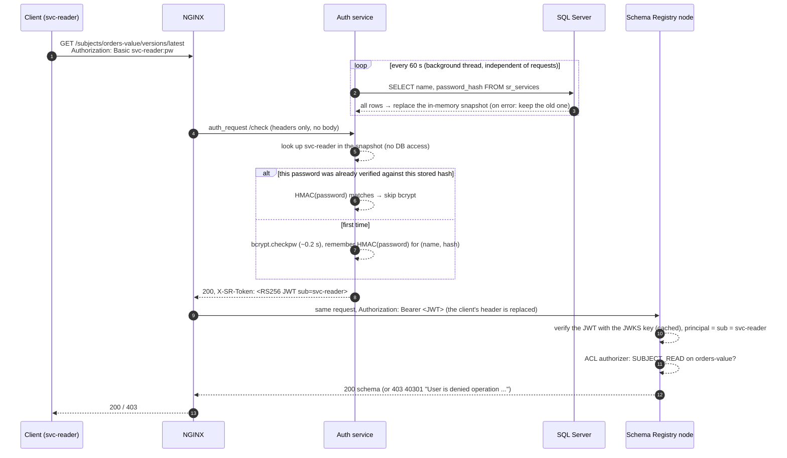
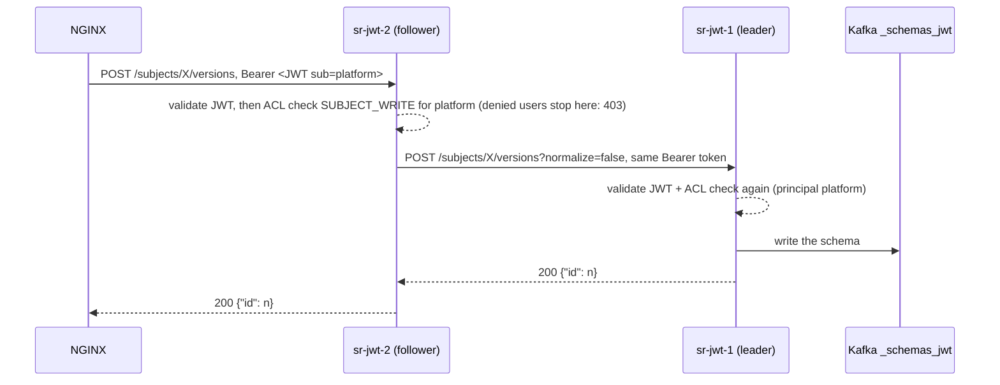

# Schema Registry behind NGINX with JWT auth (ACL authorizer)

A proof of concept for authenticating clients to Confluent Schema Registry 7.9:

- Clients keep using plain **HTTP Basic** (Service name + password).
- **NGINX** checks every request with a small **Python auth service**. That service verifies the password
  (bcrypt) against an **in-memory copy of the SQL Server table**, reloaded once a minute, and mints a short-lived
  **RS256 JWT**. Requests never query the database.
- **Schema Registry** never sees the password. It validates the JWT and takes `sub` as the principal.
  Authorization is done by the Confluent Security Plugin in **ACL mode** (`SchemaRegistryAclAuthorizer`,
  ACLs managed with `sr-acl-cli`).

Results, exact config and log evidence are in [`POC_REPORT.md`](POC_REPORT.md).

## What was done

- **The question this PoC answers:** does the ACL authorizer accept a principal that came from a bearer token?
  Confluent documents bearer tokens mostly together with RBAC.
  **It does.** SR logs `The principal is svc-reader`, and the ACL authorizer allows or denies on that name.
- **The stack:** a self-contained compose project (`sr-jwt-poc`) next to the repo's main stack. It reuses that stack's
  Kafka and SQL Server and touches nothing else.
  - NGINX: the only published port, `localhost:10000`.
  - The auth service.
  - A 2-node Schema Registry cluster, `sr-jwt-1` (leader) and `sr-jwt-2` (follower), with its own topics and no host ports.
- **The checks:** 15, automated with pytest plus a bash driver. All pass (`results/jwt-results.md`, 20 rows). They cover:
  - allow and deny by ACL, for reads, writes and `/schemas/ids`
  - wrong passwords
  - forged, expired and wrong-audience tokens, through NGINX and directly against SR
  - JWKS over plain HTTP
  - an end-to-end Avro producer and consumer
  - a SQL Server outage, the auth service refusing to start without the DB, and an auth service outage
  - follower-to-leader forwarding of writes
  - no DB query per request, and a Service added or removed in the DB taking effect within one reload
- **How the config was checked:** the SR auth config was read from the plugin jars with `javap` before it was used. The config from the brief
  (`AuthenticationHandler`, `oauthbearer.*`, `auth.mechanism=JETTY_AUTH`) turned out to be correct as written.
- **Proxy:** the proxy was first Envoy `ext_authz`, then switched to NGINX `auth_request`, which is what the team uses.

## How it works

### Components

| Component | Role | Key facts |
|---|---|---|
| **NGINX** | The only entry point. | `auth_request` on every request. Copies the auth service's `X-SR-Token` into `Authorization: Bearer …` and so **replaces** whatever the client sent. Round-robins over the SR nodes. |
| **Auth service** (`auth-service/app.py`) | Basic → JWT | FastAPI, PyJWT, bcrypt, pymssql. Keeps the **whole** `sr_services(name, password_hash)` table in memory: one `SELECT` at startup, then one every 60 s on a background thread (read-only DB login). Requests only read that copy. Serves `/jwks.json`. |
| **JWT** | Identity for SR | RS256 with `kid`. Claims: `sub=<Service>`, `iss=sr-auth-proxy`, `aud=schema-registry`, `iat`, `exp=now+300`. |
| **Schema Registry** | Validates the token and authorizes | `AuthenticationHandler` validates signature, `iss`, `aud` and `exp` against the JWKS. `sub` becomes the principal, and the ACL authorizer decides. |
| **SQL Server** | Credential store | Table `sr_services`. Only the auth service reads it. |
| **Kafka** | SR storage | `_schemas_jwt` (schemas) and `_schemas_jwt_acl` (SR ACLs). |

### Request flow

**A normal request.** Reads and writes follow the same path:



**What happens in each case.** "Reaches SR?" says whether the request gets to Schema Registry at all.

| Situation | Who answers | Client gets | Reaches SR? |
|---|---|---|---|
| Valid credentials and an ACL allows it | SR | 200 | yes |
| Valid credentials but no ACL | SR (ACL authorizer) | 403, `error_code 40301` | yes |
| Wrong password or unknown Service | Auth service, 401 | 401 + `WWW-Authenticate: Basic`, `X-Auth-Service: invalid-credentials` | no |
| No Basic header (e.g. the client sends its own Bearer) | Auth service, 401 | 401, `basic-credentials-required` | no |
| Two `Authorization` headers | NGINX | 400 (before `auth_request` runs) | no |
| SQL Server down (auth service already running) | Auth service, from the last good snapshot | 200 / 403 / 401, as normal, for every Service in the snapshot | yes (unless 401) |
| SQL Server down when the auth service starts | Auth service exits (first load failed) | **500** from NGINX (fails closed) | no |
| Service added to / removed from `sr_services` | Auth service, after the next reload (≤ 60 s) | works / 401 | — |
| Auth service down | NGINX | **500** (fails closed) | no |
| Anyone calling an SR node directly without a valid token | SR | 401 | yes, then rejected |

**A write that lands on the follower.** NGINX round-robins, so this happens:



Forwarding reuses the client's token. A forwarded write therefore fails if the token expires between NGINX and the
leader. With `exp=300` s and millisecond hops, that doesn't happen in practice.

**JWKS.** Each SR node fetches `oauthbearer.jwks.endpoint.url` and caches the keys. It fetches again when it sees a
`kid` it doesn't know. So SR→auth-service traffic is rare and not per request.

## Run the PoC (Docker, this repo)

This needs the repo's main stack to have been bootstrapped once (`../scripts/up.sh`): Kafka SCRAM users, Kafka ACLs and the
`platform` database.

```bash
cd jwt-poc
./scripts/up.sh     # keys, sr_services + bcrypt rows, auth-service, sr-jwt-1/2, nginx, SR ACLs, 2 schemas
./scripts/test.sh   # checks 1-15 (~4 min, waits for reloads) -> results/jwt-results.md, results/jwt-principal-log.txt
./scripts/down.sh   # remove this stack's containers and _schemas_jwt* topics (main stack untouched)
```

Try it by hand:

```bash
curl -u svc-reader:svc-reader-secret localhost:10000/subjects/orders-value/versions/latest    # 200
curl -u svc-reader:svc-reader-secret localhost:10000/subjects/payments-value/versions/latest  # 403
curl -u svc-reader:wrong             localhost:10000/subjects                                  # 401
docker compose logs sr-jwt-1 | grep 'The principal is'
```

| Path | What |
|---|---|
| `docker-compose.yml` | auth-service, sr-jwt-1, sr-jwt-2, nginx, tests (profile `tests`) |
| `auth-service/` | The auth service (one file) |
| `nginx/nginx.conf` | `auth_request` + upstreams |
| `schema-registry/sr-jwt.properties` | SR config (the container appends `host.name`, and on the follower `leader.eligibility=false`) |
| `mssql/init.sql` | `sr_services` table + `sr_jwt_auth` login (idempotent) |
| `tests/test_poc.py` | The checks. `scripts/test.sh` runs them in phases around the outages |
| `keys/` | The RSA key pair, generated by `up.sh`, gitignored |

## Setting it up on prem

This section turns the PoC into an installation. Steps marked **(not tested in PoC)** are recommendations
that this PoC did not verify.

### 1. Prerequisites

- **Confluent Schema Registry 7.9 with the Security Plugin:** the PoC used the `cp-schema-registry:7.9.0` image, where the plugin is under
  `/usr/share/java/confluent-security/schema-registry`. On package installs, check that the same jars are there.
- **A Confluent license for a multi-node SR cluster:** the PoC ran on the developer license, which logs
  `License for single cluster, single node`.
- **NGINX with `ngx_http_auth_request_module`:** it's compiled into the standard nginx.org packages. Check with `nginx -V`.
  `server ... resolve` in an `upstream` needs **nginx ≥ 1.27.3**. On older versions, use static addresses.
- **Python 3.12 for the auth service:** packages `fastapi uvicorn PyJWT[crypto] bcrypt pymssql`, see `auth-service/requirements.txt`.
- **SQL Server:** the platform database.
- **Kafka:** SR's storage, with a SCRAM (or other) principal for SR.

### 2. Network layout and firewall

```
 clients ──HTTPS──▶ NGINX (2+, behind a VIP/LB) ──HTTP(S)──▶ auth service (2+)  ──TDS──▶ SQL Server
                        │                                       ▲
                        └──HTTP(S)──▶ SR nodes ──JWKS fetch──────┘
                                       │  ▲ (follower → leader forwarding)
                                       └──┴──▶ Kafka
```

| From → To | Port | Why |
|---|---|---|
| Clients → NGINX | 443 | The only client-facing entry |
| NGINX → auth service | 8080 | `auth_request` |
| NGINX → SR nodes | 8081 | Proxied requests |
| SR nodes → SR nodes | 8081 | Follower → leader forwarding (uses `host.name`) |
| SR nodes → auth service | 8080 | JWKS fetch |
| SR nodes → Kafka | broker port | Storage, ACL topic, license topic |
| Auth service → SQL Server | 1433 | Password lookups |

**Block everything else to the SR nodes.** The PoC showed that SR rejects any request without a valid token. Even so, only
NGINX and the other SR nodes should be able to reach port 8081.

### 3. Database

Run `mssql/init.sql`, or the equivalent in the platform DB:
- a table `sr_services(name varchar(256) PRIMARY KEY, password_hash varchar(60))`
- a dedicated login (`sr_jwt_auth`) with **SELECT on that table only**

Services are provisioned by the platform, writing a bcrypt hash:

```python
bcrypt.hashpw(password.encode(), bcrypt.gensalt()).decode()   # cost 12 by default, ~0.2-0.3 s to verify
```

Every change (new Service, deleted Service, new password) takes effect on each auth-service instance at its next
reload, so within `RELOAD_SECONDS` (60 s). Until then, that instance still uses the old row. In particular, an old
password keeps working for up to 60 s. The DB load is one connection and one full `SELECT` per instance per minute,
whatever the request rate.

### 4. Signing keys

```bash
openssl genpkey -algorithm RSA -pkeyopt rsa_keygen_bits:2048 -out private.pem
```

- **Where the private key lives:** only on the auth-service hosts, readable only by the service user, ideally from a secrets store.
- **Same key everywhere:** every auth-service instance must use the same key and `kid` (`JWT_KID`), so any instance can serve
  `/jwks.json` and any SR node accepts any instance's tokens.
- **Rotation (not tested in PoC):** publish the new key next to the old one in the JWKS (two entries, different `kid`), then
  switch signing to the new key. Remove the old key only after the token TTL (5 min) has passed. The current
  `app.py` serves one key, so it would need a small change.

### 5. Auth service

Run 2+ instances, for example under systemd, behind the NGINX `upstream auth_service`:

```ini
# /etc/systemd/system/sr-auth.service
[Service]
User=sr-auth
WorkingDirectory=/opt/sr-auth
Environment=DB_HOST=sqlprod01 DB_NAME=platform DB_USER=sr_jwt_auth
EnvironmentFile=/etc/sr-auth/secrets.env           # DB_PASSWORD=...
Environment=JWT_PRIVATE_KEY=/etc/sr-auth/private.pem JWT_KID=sr-auth-2026-10
Environment=JWT_ISSUER=sr-auth-proxy JWT_AUDIENCE=schema-registry JWT_TTL_SECONDS=300 RELOAD_SECONDS=60
ExecStart=/opt/sr-auth/venv/bin/uvicorn app:app --host 0.0.0.0 --port 8080 --workers 2 --no-access-log
Restart=always
```

Things to know:
- **The snapshot is per process.** Each instance and each uvicorn worker loads the whole table itself, so the DB sees
  one `SELECT` per process per minute. Processes reload independently, so for up to 60 s after a change, two
  instances can disagree.
- **DB outage:** a running process keeps its last good snapshot indefinitely, and logs `reload failed, keeping the snapshot
  from N s ago`. A process that **starts** while the DB is down exits (first load fails), so don't restart instances
  during a DB outage. `GET /healthz` shows `snapshot_age_s` and `db_errors`.
- **bcrypt** runs once per (Service, stored hash, password) per process. After that, a matching HMAC skips it. An
  unknown name returns 401 without running bcrypt, so the response time reveals whether a name exists. If that matters,
  run bcrypt against a dummy hash.
- **The DB connection:** pymssql opens one per reload. For encrypted TDS to SQL Server, configure FreeTDS encryption
  **(not tested in PoC)**.
- **Exposure:** `/check` and `/jwks.json` are the only endpoints. Only NGINX and the SR nodes need to reach the service.

### 6. Schema Registry nodes

Use `schema-registry/sr-jwt.properties` as the base. Per node, set `host.name` to a name the other nodes can resolve.
Followers get `leader.eligibility=false` if you want a fixed leader. Point the JWKS URL at the auth-service VIP, not
at a single host:

```properties
listeners=http://0.0.0.0:8081
host.name=sr01.example.internal

kafkastore.bootstrap.servers=SASL_SSL://kafka01:9093,...
kafkastore.security.protocol=SASL_SSL
kafkastore.sasl.mechanism=SCRAM-SHA-256
kafkastore.sasl.jaas.config=org.apache.kafka.common.security.scram.ScramLoginModule required username="schema-registry" password="...";
kafkastore.topic=_schemas
schema.registry.group.id=schema-registry

# Authentication: JWT only. Leave authentication.method unset (NONE).
rest.servlet.initializor.classes=io.confluent.common.security.jetty.initializer.AuthenticationHandler
oauthbearer.jwks.endpoint.url=https://sr-auth.example.internal/jwks.json
oauthbearer.expected.issuer=sr-auth-proxy
oauthbearer.expected.audience=schema-registry
oauthbearer.sub.claim.name=sub

# Authorization: Security Plugin, ACL mode
resource.extension.class=io.confluent.kafka.schemaregistry.security.SchemaRegistrySecurityResourceExtension
confluent.schema.registry.authorizer.class=io.confluent.kafka.schemaregistry.security.authorizer.schemaregistryacl.SchemaRegistryAclAuthorizer
confluent.schema.registry.auth.mechanism=JETTY_AUTH
confluent.schema.registry.acl.topic=_schemas_acl

confluent.license=<license key>
confluent.license.topic=_confluent-license
```

Notes:
- **JWKS over HTTPS:** the PoC used `http://`. The plugin documents HTTP(S), and SSL settings for the JWKS client come from
  the `ssl.*` keys **(HTTPS not tested in PoC)**.
- **Kafka ACLs for SR's principal:** the main stack (`../scripts/up.sh`) grants broad prefix ACLs (not a
  verified minimum):
  - topics `_schemas*`, `_confluent-license*`, `_confluent-command*`: Read, Write, Describe, DescribeConfigs, Create
  - groups `schema-registry*`, `sr-*`, `confluent-license*`, `_confluent-license*`: Read, Describe
  - the cluster: Describe, DescribeConfigs
- **Startup order:** start SR after the auth service is reachable. The PoC always started the auth service first. SR starting
  while JWKS is unreachable **was not tested**.

### 7. SR ACLs

ACLs live in Kafka (`_schemas_acl`), so one `sr-acl-cli` run against any node's config applies to the whole cluster.
Principals are the Service names, exactly as they appear in the token's `sub`:

```bash
sr-acl-cli --config /etc/schema-registry/schema-registry.properties --add -s '*' -p platform -o '*'
sr-acl-cli --config ... --add -s orders-value -p svc-reader -o SUBJECT_READ
sr-acl-cli --config ... --list
```

`SUBJECT_READ` on a subject also allows `GET /schemas/ids/<id>` for that subject's schema ids. Other ids are 403.

### 8. NGINX

Use `nginx/nginx.conf` as the base. On prem, add TLS on the listener and use real upstream addresses:

```nginx
upstream auth_service    { server auth01:8080; server auth02:8080; }
upstream schema_registry { server sr01:8081;   server sr02:8081; }

server {
  listen 443 ssl;
  ssl_certificate     /etc/nginx/tls/sr.crt;
  ssl_certificate_key /etc/nginx/tls/sr.key;
  client_max_body_size 20m;

  location / {
    auth_request /_auth;
    auth_request_set $sr_token    $upstream_http_x_sr_token;
    auth_request_set $auth_reason $upstream_http_x_auth_service;
    add_header X-Auth-Service $auth_reason always;
    proxy_set_header Authorization "Bearer $sr_token";   # replaces the client's header
    proxy_pass http://schema_registry;
  }

  location = /_auth {
    internal;
    proxy_pass http://auth_service/check;
    proxy_pass_request_body off;
    proxy_set_header Content-Length "";
    proxy_set_header X-Original-URI    $request_uri;
    proxy_set_header X-Original-Method $request_method;
    proxy_connect_timeout 2s;
    proxy_read_timeout 5s;
  }
}
```

If clients should see **503** rather than 500 when the auth service is down or unreachable, add
`error_page 500 =503 /50x.json;` or similar **(not tested in PoC)**.

### 9. Clients

Nothing changes for clients except the URL. They keep sending Basic:

```properties
schema.registry.url=https://sr.example.internal
basic.auth.credentials.source=USER_INFO
basic.auth.user.info=svc-reader:<password>
auto.register.schemas=false
use.latest.version=true
```

The Python `confluent-kafka` 2.8 Avro producer and consumer were tested this way (check 10).

### 10. Operating it

- **Who is calling:**
  - the SR request log (`io.confluent.rest-utils.requests`) shows the principal on every line, e.g. `- svc-reader [..] "GET ..." 200`
  - the NGINX access log shows `upstream=-` for requests that never reached SR
- **Debug logging:** set `log4j.logger.io.confluent.common.security=DEBUG` and
  `log4j.logger.io.confluent.kafka.schemaregistry.security=DEBUG`. They log `The principal is ...` and each ACL decision.
  These are verbose, so don't leave them on in production.
- **Health checks:**
  - auth service: `GET /healthz` (`services`, `snapshot_age_s`, `db_loads`, `db_errors`, `bcrypt_checks`, `verified_hits`)
  - SR: any request without a token returns 401 once Jetty is up
- **Alert on:**
  - NGINX `auth request unexpected status` in its error log: the auth service is down or unreachable
  - `snapshot_age_s` in `/healthz` growing past ~2 reload intervals: the DB is unreachable and the snapshot is getting stale

## Limits found in the PoC

The differences from the brief, with details, are in `POC_REPORT.md` → "Where behaviour differed from the design":

- `auth_request` passes only 2xx, 401 and 403 through. Anything else becomes 500.
- NGINX rejects a request with two `Authorization` headers (400).
- SR has no Basic fallback in this config. Direct Basic gets 401.
- A Service with no ACLs at all gets 403 (not an empty list) on `GET /subjects`. The subject list is filtered on
  `SUBJECT_COMPATIBILITY_READ`, not `SUBJECT_READ`.
- With `server ... resolve`, NGINX drops the auth service while its DNS name is gone (container stopped). It recovers
  within ~5 s of the name coming back (check 12c: 4 s). With static addresses on prem, this doesn't apply.
- The developer license is single-node.
- **Not tested:** TLS anywhere, JWKS key rotation, SR starting while JWKS is unreachable, load and latency.
